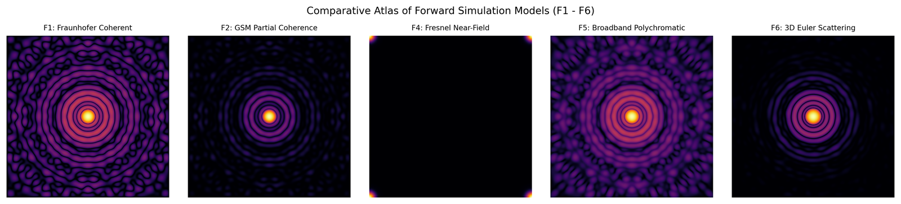
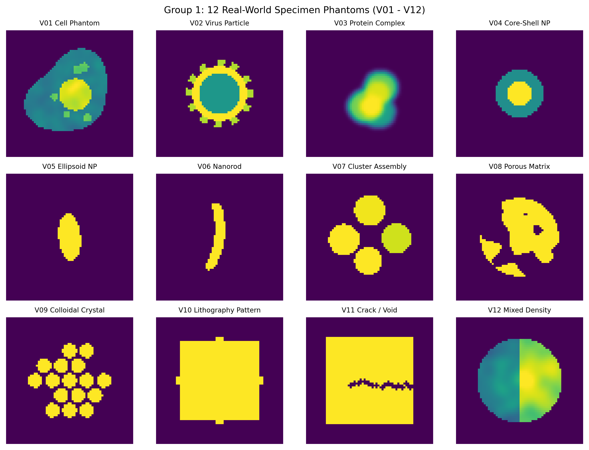
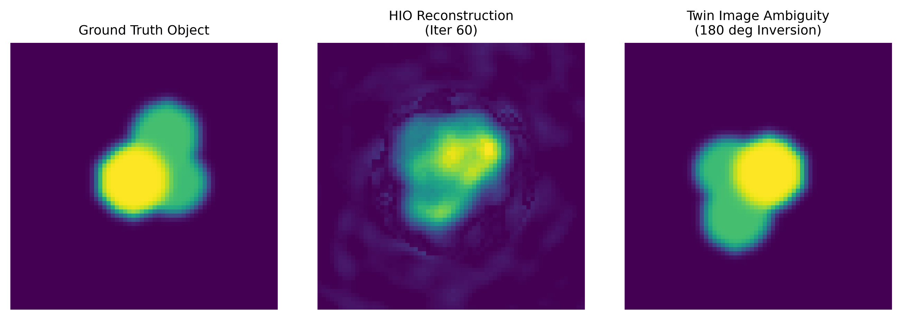

# OpenDiffraction: Physics-Based Synthetic Coherent Diffraction Patterns for Phase Retrieval and Inverse Problems

[](https://creativecommons.org/licenses/by/4.0/)
[](https://opensource.org/licenses/BSD-2-Clause)
[](https://www.python.org/downloads/)
[](https://doi.org/10.1038/s41524-025-01569-7)

**OpenDiffraction 2.0** is an open-source, reproducible, physics-based synthetic diffraction imaging generator and machine learning benchmark suite designed for public publication on Kaggle. It simulates Fraunhofer coherent X-ray diffraction, Gaussian Schell-model partial spatial coherence, mixed Poisson shot noise, Gaussian detector electronics noise, central beam stops, and irregular detector gaps.

OpenDiffraction produces datasets that are directly compatible with the Deep Phase Retrieval ([DPR](https://github.com/sungyun98/DPR)) neural network while offering an extended scientific format containing unscaled physical ground-truth objects, uncorrupted ideal intensities, expected photon rates, and complete experimental manifests.

<p align="center">
  
</p>
<p align="center">
  <em>Figure 1: Complete physics forward simulation pipeline from real-space ground-truth specimen density through coherent / partially coherent wavefield propagation down to photon-counting statistics, Gaussian electronics noise, central beamstop shadows, and detector defects.</em>
</p>

---

## Key Features

1. **Modular Forward Physics Models (F1 - F6)**:
   - **Model F1**: Far-field coherent Fraunhofer diffraction from real or complex transmission functions.
   - **Model F2**: Partial spatial coherence using Gaussian Schell-model (GSM) autocorrelation damping or orthogonal multimode decomposition.
   - **Model F3**: Thin-specimen coherent transmission under aberrated probe illumination (defocus, astigmatism, coma, jitter).
   - **Model F4**: Fresnel near-field diffraction with wavelength, sample-to-detector distance, and pixel pitch in SI units.
   - **Model F5**: Polychromatic pink-beam diffraction with wavelength-dependent reciprocal-space coordinate dilation.
   - **Model F6**: 3D particle scattering from scalar volumes with continuous Euler rotations and Born projection approximation.

<p align="center">
  
</p>
<p align="center">
  <em>Figure 2: Forward physics simulation models F1 through F6 capturing Fraunhofer diffraction, Gaussian Schell-model partial spatial coherence, probe wavefront aberrations, SI-unit Fresnel diffraction, polychromatic energy bandwidth, and 3D Euler rotations with Born projection.</em>
</p>

2. **48 Controlled Experimental Variation Profiles (V01 - V48)**:
   - **Group 1 (V01 - V12)**: Real-World Specimens (cells, viruses, protein aggregates, core-shell nanoparticles, nanorods, porous aerogels, colloidal assemblies, lithography, cracks).
   - **Group 2 (V13 - V20)**: Illumination & Coherence (plane waves, moderate/low coherence, asymmetric coherence, wavefront curvature, pointing jitter, pink beams).
   - **Group 3 (V21 - V30)**: Detector Realism (readout noise, quantization, Poisson shot noise, dynamic range saturation, dead pixels, stripes, module gaps).
   - **Group 4 (V31 - V36)**: Background & Parasitic Scattering (gas scattering, carbon film halos, solvent rings, slit flare, cosmic ray hits).
   - **Group 5 (V37 - V42)**: Acquisition & Hit Finding (high-flux hits, low-flux hits, beam centering, multi-particle hits, empty jet non-hits).
   - **Group 6 (V43 - V48)**: Advanced Physics & Out-of-Distribution (pure phase objects, strong vortices, 3D rotations, compound stress regimes).

<p align="center">
  
</p>
<p align="center">
  <em>Figure 3: Synthetic specimen phantoms spanning biological structures (cells, viruses, protein clusters) to nanomaterials (core-shell nanoparticles, nanorods, colloidal crystals, internal fracture defects).</em>
</p>

3. **6 Acquisition Scenarios (S1 - S6)**:
   - **S1 (XFEL Single-Particle)**: Femtosecond pulses, low photon counts, high partial coherence.
   - **S2 (Synchrotron CDI)**: High monochromatic flux, long exposures, gas background.
   - **S3 (Nanomaterials)**: Nanorods, core-shell particles, moderate photon budget.
   - **S4 (Biological CDI)**: Low-dose biological phantoms, water halo, low damage threshold.
   - **S5 (Optical Tabletop)**: Laser diode CDI, high coherence, visible wavelength.
   - **S6 (Detector QA)**: Complex dead modules, bad pixels, high electronic readout noise.

4. **12 Scientific Machine Learning Benchmark Tasks (T1 - T12)**:
   - T1: Supervised Phase Retrieval
   - T2: Diffraction Pattern Denoising
   - T3: Inpainting and Beam-Stop Reconstruction
   - T4: Single-Shot Hit Finding and Classification
   - T5: Detector Defect Segmentation
   - T6: Particle Morphology Classification
   - T7: Physical Parameter Estimation
   - T8: Out-of-Distribution Anomaly Detection
   - T9: Cross-Beamline Domain Generalization
   - T10: Self-Supervised Representation Learning
   - T11: Phase Uncertainty Quantification
   - T12: Physics-Consistent Inversion

<p align="center">
  
</p>
<p align="center">
  <em>Figure 4: Baseline iterative phase retrieval (HIO + ER) achieving real-space object reconstruction and phase-ambiguity alignment from masked diffraction intensities alone.</em>
</p>

<p align="center">
  
</p>
<p align="center">
  <em>Figure 5: 12 standardized machine learning benchmark tasks (T1 to T12) establishing evaluation protocols across inverse imaging, denoising, hit-finding, and domain adaptation.</em>
</p>

5. **Official CXI Format Support**:
   - NeXus-compliant CXI (`.cxi`) export conforming to CXIDB standards (`cxidb.org/cxi.html`).

---

## Quickstart

### Installation
```bash
git clone https://github.com/KindlyGentleman/opendiffraction.git
cd opendiffraction
pip install -e .
```

### Command-Line Interface

Generate quick smoke-test dataset (48 samples, 1 per profile):
```bash
python -m opendiffraction generate --preset quick --output ./output --seed 42
```

Generate full starter benchmark (2,400 samples):
```bash
python -m opendiffraction generate --preset starter --output ./output --seed 42
```

Generate using YAML config preset with CXI and task manifest exports:
```bash
python -m opendiffraction generate --config configs/xfel.yaml --export-cxi --export-tasks
```

Validate physics, statistics, and HDF5 integrity:
```bash
python -m opendiffraction validate --dataset ./output --reports-dir ./reports
```

Generate publication figures (16 IEEE figures and contact sheets):
```bash
python -m opendiffraction visualize --dataset ./output --output ./output/figures --suite 16
```

Generate animated parameter sweep GIFs:
```bash
python -m opendiffraction animate --output ./output/figures/sweeps --type both
```

Package dataset for Kaggle release:
```bash
python -m opendiffraction package --dataset ./output --output ./kaggle_release --username YOUR_KAGGLE_USERNAME
```

---

## Configuration Presets

Pre-packaged YAML configurations are located in `configs/`:
- `quick.yaml`: 48 samples (1 per profile V01 - V48) for fast end-to-end testing.
- `starter.yaml`: 2,400 samples across all 48 profiles (50 per profile).
- `full.yaml`: 9,600 samples for production machine learning training.
- `xfel.yaml`: S1 XFEL single-particle acquisition scenario.
- `synchrotron.yaml`: S2 synchrotron beamline scenario.
- `optical_lab.yaml`: S5 optical tabletop CDI scenario.

---

## Notebooks

- [`notebooks/01_explore_opendiffraction.ipynb`](notebooks/01_explore_opendiffraction.ipynb): Dataset inspection, shard loading, and visualization.
- [`notebooks/02_phase_retrieval_baseline.ipynb`](notebooks/02_phase_retrieval_baseline.ipynb): Iterative phase retrieval baseline using HIO and Error Reduction.

---

## References

1. Lee et al. (2025), *"Deep-learning real-time phase retrieval of imperfect diffraction patterns from X-ray free-electron lasers"*, Nature Communications / npj Computational Materials, DOI: [10.1038/s41524-025-01569-7](https://doi.org/10.1038/s41524-025-01569-7).
2. Upstream DPR Repository: [https://github.com/sungyun98/DPR](https://github.com/sungyun98/DPR) (BSD 2-Clause License).
3. CXIDB Coherent X-ray Imaging Data Bank: [https://cxidb.org/](https://cxidb.org/).
4. Detailed compatibility and upstream history: [`docs/DPR_COMPATIBILITY.md`](docs/DPR_COMPATIBILITY.md).

---

## License

- Scientific Data: [Creative Commons Attribution 4.0 International (CC BY 4.0)](LICENSE)
- Source Code: [BSD 2-Clause License](LICENSE)
