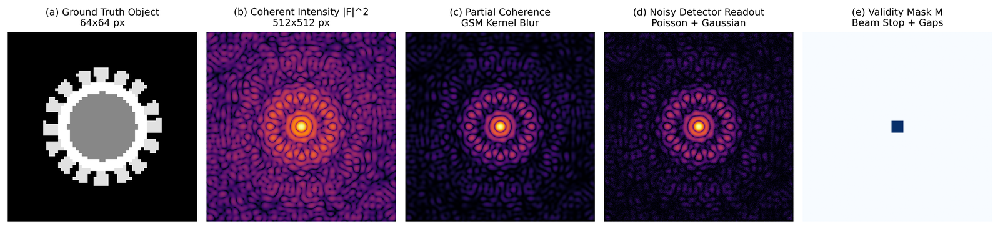
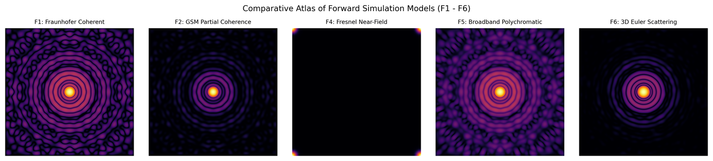
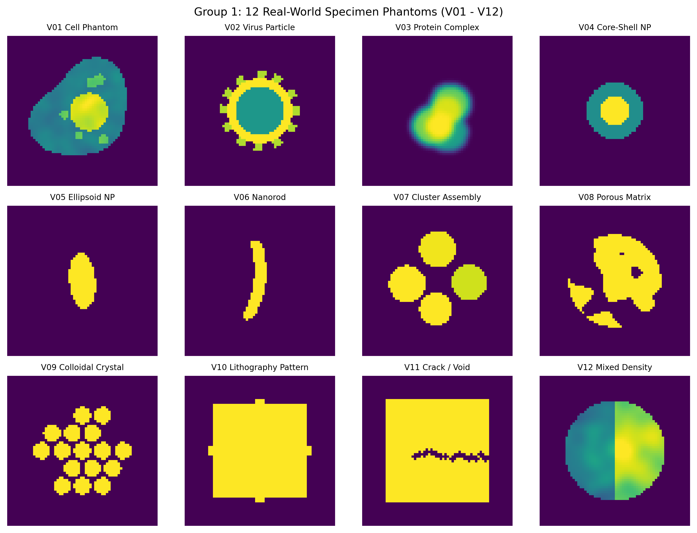
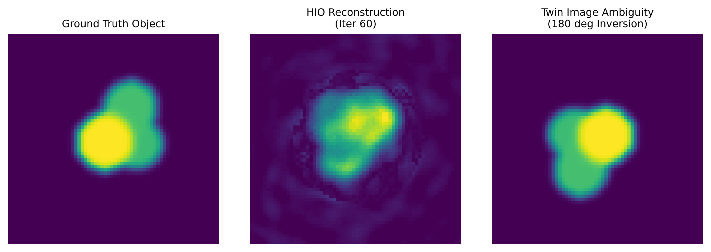
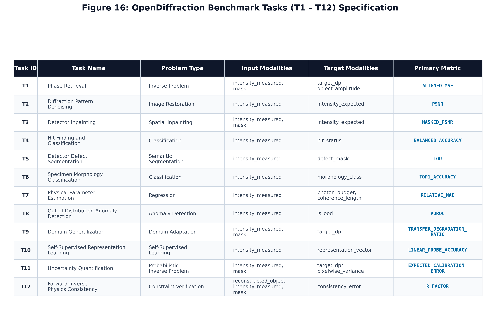

# OpenDiffraction: Physics-Based Synthetic Coherent Diffraction Patterns for Phase Retrieval and Inverse Problems

[](https://creativecommons.org/licenses/by/4.0/)
[](https://opensource.org/licenses/BSD-2-Clause)
[](https://www.python.org/downloads/)
[](https://doi.org/10.1038/s41524-025-01569-7)

**Creator & Principal Maintainer:** [Muhammad Kamal](https://github.com/KindlyGentleman) (GitHub: `@KindlyGentleman`, Kaggle: `@hamadmuhammadkamal`)  
**GitHub Repository:** [https://github.com/KindlyGentleman/opendiffraction](https://github.com/KindlyGentleman/opendiffraction)  
**Kaggle Dataset:** [https://www.kaggle.com/datasets/hamadmuhammadkamal/opendiffraction-synthetic-cdi](https://www.kaggle.com/datasets/hamadmuhammadkamal/opendiffraction-synthetic-cdi)

---

> [!IMPORTANT]
> **Dataset Scope Notice: 48-Sample Quick-Release Benchmark**  
> The published release on Kaggle is a **48-sample Quick-Release Benchmark** containing exactly 1 representative sample per physical profile (`V01` through `V48`: 35 train, 5 validation, 3 test, 5 test_ood).  
> **48 samples are strictly insufficient for training supervised deep neural networks from scratch.**  
> This benchmark is designed for:
> 1. Rapid algorithmic benchmarking of classical iterators (ER, HIO, Shrinkwrap, RAAR).
> 2. Zero-shot and fine-tuning evaluation of pre-trained deep phase retrieval networks.
> 3. Out-of-distribution (OOD) stress testing across partial coherence, beam stops, and complex phase objects.
> 
> To generate large-scale training volumes ($10^4$ to $10^5$ samples) for training neural networks from scratch, use the generator from GitHub:
> ```bash
> python -m opendiffraction.cli generate --preset full --samples 10000 --output ./my_full_dataset
> ```

---

**OpenDiffraction 2.0** is an open-source, reproducible, physics-based synthetic diffraction imaging generator and machine learning benchmark suite designed for public publication on Kaggle. It simulates Fraunhofer coherent X-ray diffraction, Gaussian Schell-model partial spatial coherence, mixed Poisson shot noise, Gaussian detector electronics noise, central beam stops, and irregular detector gaps.

OpenDiffraction produces datasets that are directly compatible with the Deep Phase Retrieval ([DPR](https://github.com/sungyun98/DPR)) neural network while offering an extended scientific format containing unscaled physical ground-truth objects, uncorrupted ideal intensities, expected photon rates, and complete experimental manifests.

<p align="center">
  
</p>
<p align="center">
  <em>Figure 1: Complete physics forward simulation pipeline from real-space ground-truth specimen density through coherent / partially coherent wavefield propagation down to photon-counting statistics, Gaussian electronics noise, central beamstop shadows, and detector defects.</em>
</p>

---

## Key Features

1. **Modular Forward Physics Models (F1 - F6)**:
   - **Model F1**: Far-field coherent Fraunhofer diffraction from real or complex transmission functions.
   - **Model F2**: Partial spatial coherence using Gaussian Schell-model (GSM) autocorrelation damping or orthogonal multimode decomposition.
   - **Model F3**: Thin-specimen coherent transmission under aberrated probe illumination (defocus, astigmatism, coma, jitter).
   - **Model F4**: Fresnel near-field diffraction with wavelength, sample-to-detector distance, and pixel pitch in SI units.
   - **Model F5**: Polychromatic pink-beam diffraction with wavelength-dependent reciprocal-space coordinate dilation.
   - **Model F6**: 3D particle scattering from scalar volumes with continuous Euler rotations and Born projection approximation.

<p align="center">
  
</p>
<p align="center">
  <em>Figure 2: Forward physics simulation models F1 through F6 capturing Fraunhofer diffraction, Gaussian Schell-model partial spatial coherence, probe wavefront aberrations, SI-unit Fresnel diffraction, polychromatic energy bandwidth, and 3D Euler rotations with Born projection.</em>
</p>

2. **48 Controlled Experimental Variation Profiles (V01 - V48)**:
   - **Group 1 (V01 - V12)**: Real-World Specimens (cells, viruses, protein aggregates, core-shell nanoparticles, nanorods, porous aerogels, colloidal assemblies, lithography, cracks).
   - **Group 2 (V13 - V20)**: Illumination & Coherence (plane waves, moderate/low coherence, asymmetric coherence, wavefront curvature, pointing jitter, pink beams).
   - **Group 3 (V21 - V30)**: Detector Realism (readout noise, quantization, Poisson shot noise, dynamic range saturation, dead pixels, stripes, module gaps).
   - **Group 4 (V31 - V36)**: Background & Parasitic Scattering (gas scattering, carbon film halos, solvent rings, slit flare, cosmic ray hits).
   - **Group 5 (V37 - V42)**: Acquisition & Hit Finding (high-flux hits, low-flux hits, beam centering, multi-particle hits, empty jet non-hits).
   - **Group 6 (V43 - V48)**: Advanced Physics & Out-of-Distribution (pure phase objects, strong vortices, 3D rotations, compound stress regimes).

<p align="center">
  
</p>
<p align="center">
  <em>Figure 3: Synthetic specimen phantoms spanning biological structures (cells, viruses, protein clusters) to nanomaterials (core-shell nanoparticles, nanorods, colloidal crystals, internal fracture defects).</em>
</p>

3. **6 Acquisition Scenarios (S1 - S6)**:
   - **S1 (XFEL Single-Particle)**: Femtosecond pulses, low photon counts, high partial coherence.
   - **S2 (Synchrotron CDI)**: High monochromatic flux, long exposures, gas background.
   - **S3 (Nanomaterials)**: Nanorods, core-shell particles, moderate photon budget.
   - **S4 (Biological CDI)**: Low-dose biological phantoms, water halo, low damage threshold.
   - **S5 (Optical Tabletop)**: Laser diode CDI, high coherence, visible wavelength.
   - **S6 (Detector QA)**: Complex dead modules, bad pixels, high electronic readout noise.

4. **12 Scientific Machine Learning Benchmark Tasks (T1 - T12)**:
   - T1: Supervised Phase Retrieval
   - T2: Diffraction Pattern Denoising
   - T3: Inpainting and Beam-Stop Reconstruction
   - T4: Single-Shot Hit Finding and Classification
   - T5: Detector Defect Segmentation
   - T6: Particle Morphology Classification
   - T7: Physical Parameter Estimation
   - T8: Out-of-Distribution Anomaly Detection
   - T9: Cross-Beamline Domain Generalization
   - T10: Self-Supervised Representation Learning
   - T11: Phase Uncertainty Quantification
   - T12: Physics-Consistent Inversion

<p align="center">
  
</p>
<p align="center">
  <em>Figure 4: Baseline iterative phase retrieval (HIO + ER) achieving real-space object reconstruction and phase-ambiguity alignment from masked diffraction intensities alone.</em>
</p>

<p align="center">
  
</p>
<p align="center">
  <em>Figure 5: 12 standardized machine learning benchmark tasks (T1 to T12) establishing evaluation protocols across inverse imaging, denoising, hit-finding, and domain adaptation.</em>
</p>

5. **Official CXI Format Support**:
   - NeXus-compliant CXI (`.cxi`) export conforming to CXIDB standards (`cxidb.org/cxi.html`).

---

## Quickstart

### Installation
```bash
git clone https://github.com/KindlyGentleman/opendiffraction.git
cd opendiffraction
pip install -e .
```

### Loading the Kaggle Shards in Python
```python
import h5py
import numpy as np

# Load in-distribution test shard
with h5py.File("data/test_000.h5", "r") as f:
    inputs = f["input"][:]           # (3, 1, 512, 512) float32
    targets = f["target"][:]         # (3, 1, 64, 64) float32 (DPR false_scale convention)
    masks = f["mask"][:]             # (3, 1, 512, 512) bool
    clean_amp = f["object_amplitude"][:] # (3, 1, 64, 64) float32 (physical ground truth [0, 1])

print(f"Loaded {len(inputs)} test samples.")
```

### Direct Upstream DPR Loading
```python
from deeppr import CustomDataset

# Turnkey loading with upstream DPR CustomDataset loader
ds = CustomDataset("data/train_000.h5")
inp, tgt, msk = ds[0]
print("DPR shapes:", inp.shape, tgt.shape, msk.shape)
```

---

## Citation

If you use OpenDiffraction in your work, please cite the dataset and foundational scientific publication:

### Citing the Dataset
```bibtex
@misc{kamal2026opendiffraction,
  author       = {Kamal, Muhammad},
  title        = {{OpenDiffraction: Physics-Based Synthetic Diffraction Imaging Dataset}},
  year         = {2026},
  publisher    = {GitHub \& Kaggle},
  howpublished = {\url{https://github.com/KindlyGentleman/opendiffraction}},
  note         = {Kaggle: \url{https://www.kaggle.com/datasets/hamadmuhammadkamal/opendiffraction-synthetic-cdi}}
}
```

### Foundational DPR Scientific Reference
```bibtex
@article{lee2025deep,
  author    = {Lee, Sung Yun and Cho, Do Hyung and Jung, Chulho and Sung, Daeho and Nam, Daewoong and Kim, Sangsoo and Song, Changyong},
  title     = {Deep-learning real-time phase retrieval of imperfect diffraction patterns from {X}-ray free-electron lasers},
  journal   = {npj Computational Materials},
  volume    = {11},
  number    = {1},
  pages     = {68},
  year      = {2025},
  publisher = {Nature Publishing Group},
  doi       = {10.1038/s41524-025-01569-7}
}
```

---

## Non-Endorsement & Independence Disclosure

OpenDiffraction was independently created and curated by Muhammad Kamal as an open-source synthetic dataset and scientific benchmark. It is not an official project of Pohang University of Science and Technology (POSTECH), the FXDI research group, or the authors of DPR. None of these entities have reviewed, approved, funded, or endorsed OpenDiffraction.

---

## References

1. **Foundational Paper**: Lee, S. Y., Cho, D. H., Jung, C., Sung, D., Nam, D., Kim, S., & Song, C. (2025). *Deep-learning real-time phase retrieval of imperfect diffraction patterns from X-ray free-electron lasers*. npj Computational Materials 11, 68. DOI: [10.1038/s41524-025-01569-7](https://doi.org/10.1038/s41524-025-01569-7).
2. **Upstream DPR Repository**: [https://github.com/sungyun98/DPR](https://github.com/sungyun98/DPR) (BSD 2-Clause License).
3. **Coherent X-ray Imaging Data Bank (CXIDB)**: Maia, F. R. (2012). *The Coherent X-ray Imaging Data Bank*. Nature Methods 9, 854–855. [https://cxidb.org/](https://cxidb.org/).

---

## License

- **Dataset, Figures, & Metadata**: [Creative Commons Attribution 4.0 International (CC BY 4.0)](https://creativecommons.org/licenses/by/4.0/)
- **Source Code & Scripts**: [BSD 2-Clause License](https://opensource.org/licenses/BSD-2-Clause) (Copyright &copy; 2026 Muhammad Kamal)
